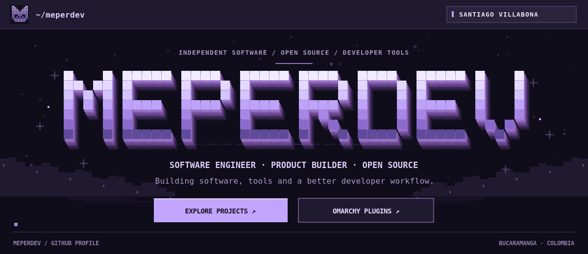
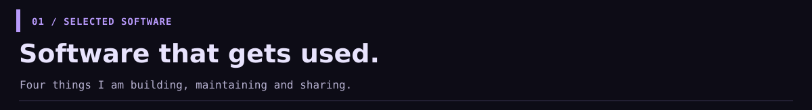
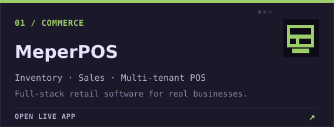
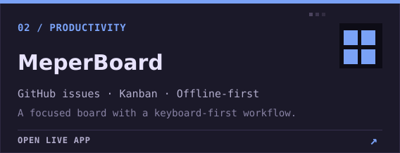
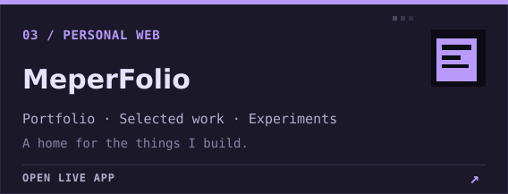
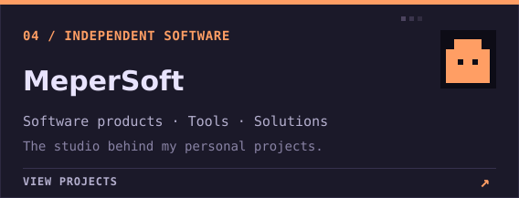
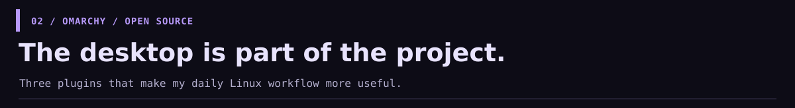
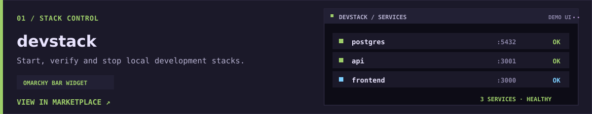
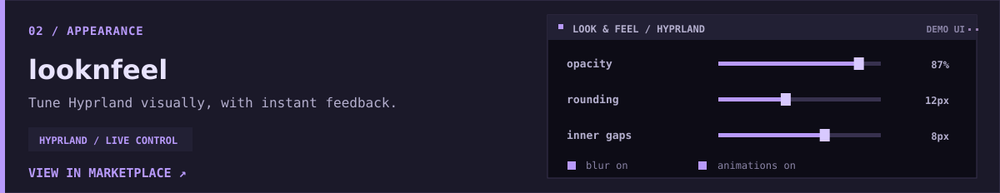
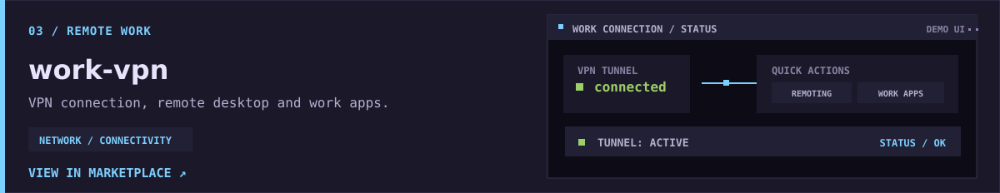

<!-- Profile of Santiago Villabona · visual identity: meperdev -->

  

  <a href="https://folio.mepersoft.app/"><b>Portfolio ↗</b></a>&nbsp;&nbsp; · &nbsp;&nbsp;
  <a href="https://github.com/meperdev?tab=repositories"><b>Projects ↗</b></a>&nbsp;&nbsp; · &nbsp;&nbsp;
  <a href="https://plugins.omarchy.org/"><b>Omarchy marketplace ↗</b></a>

 

### Hey, I'm Santiago.

Software engineer and independent builder in **Bucaramanga, Colombia**. I build full-stack products, local-first tools and developer experiences that make everyday work better.

`C# / .NET` · `TypeScript` · `NestJS` · `Next.js` · `PostgreSQL` · `Docker` · `Arch / Omarchy`

 

  
  
  
  

  <a href="https://pos.mepersoft.app/">MeperPOS ↗</a> &nbsp; · &nbsp;
  <a href="https://meperboard.vercel.app/">MeperBoard ↗</a> &nbsp; · &nbsp;
  <a href="https://folio.mepersoft.app/">MeperFolio ↗</a> 
  <a href="https://github.com/meperdev/MeperPOS">POS source</a> · <a href="https://github.com/meperdev/MeperBoard">Board source</a> · <a href="https://github.com/meperdev/MeperFolio">Folio source</a>

 

  
  <a href="https://plugins.omarchy.org/plugin.html?id=meperdonas.devstack">Marketplace ↗</a> · <a href="https://github.com/meperdev/omarchy-devstack">Source code ↗</a>
    
  
  <a href="https://plugins.omarchy.org/plugin.html?id=meperdonas.looknfeel">Marketplace ↗</a> · <a href="https://github.com/meperdev/omarchy-looknfeel">Source code ↗</a>
    
  
  <a href="https://plugins.omarchy.org/plugin.html?id=meperdonas.work-vpn">Marketplace ↗</a> · <a href="https://github.com/meperdev/omarchy-work-vpn">Source code ↗</a>

Plugin UI panels are visual examples, not live status. The cards link to their marketplace entries.

 

---

  <b>Built to work. Made to be changed.</b>  
  <a href="https://folio.mepersoft.app/">Portfolio</a> · <a href="https://github.com/meperdev">GitHub</a> · <a href="https://plugins.omarchy.org/">Omarchy plugins</a>

Independent profile, visually inspired by Omarchy; not affiliated with Omarchy.
